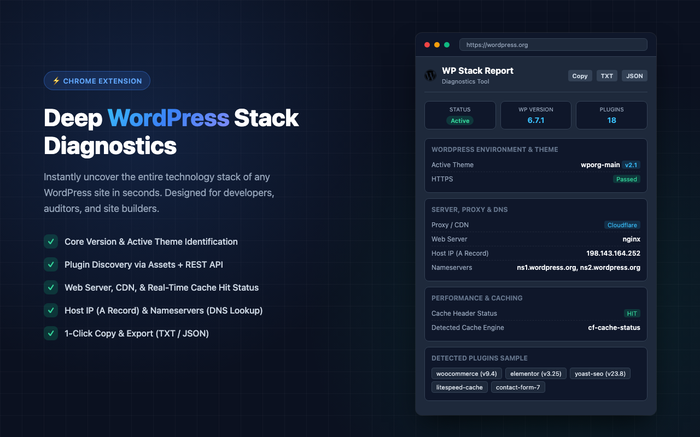

# WP Detector 🔍

> A modern, developer-first Chrome extension (Manifest V3) for deep WordPress stack inspection, plugin discovery, server diagnostics, and caching analysis.



---

## 🚀 Overview

**WP Detector** instantly analyzes any website to detect and report the complete underlying WordPress ecosystem. From version checks and theme details to hidden background plugins detected via REST API namespaces, server software, and live HTTP cache statuses—WP Detector delivers actionable insights in a clean, WordPress Admin-inspired dashboard.

---

## ✨ Features

- **WordPress Core & Theme Detection:**
  - Accurately checks whether a site is powered by WordPress.
  - Identifies core version and compares against the official WordPress API.
  - Displays active theme name, version, and direct links to the official WordPress theme directory.

- **Deep Plugin Discovery (Assets + REST API):**
  - Scans loaded scripts and stylesheets for plugin asset paths and version numbers.
  - Probes WordPress REST API namespaces (`/wp-json` and `?rest_route=/`) to discover active background plugins that do not load frontend assets.
  - Interactive search bar to filter through large plugin inventories instantly.
  - Direct links to WordPress.org plugin directory pages.

- **Server, Reverse Proxy & CDN Detection:**
  - Identifies underlying web server software (Nginx, Apache, LiteSpeed, etc.).
  - Detects edge proxies and platforms (Cloudflare, Sucuri, WP Engine, Kinsta, Pantheon).
  - Displays PHP version when exposed in response headers.

- **Real-Time Cache Inspection:**
  - Inspects response headers (`cf-cache-status`, `x-cache`, `x-litespeed-cache`, etc.).
  - Identifies real-time cache behavior: `HIT`, `MISS`, `BYPASS`, or `DYNAMIC`.

- **DNS & Host Resolution:**
  - Resolves domain public IPv4 Host IP (A record) and authoritative Nameservers (NS records) via secure Google DNS-over-HTTPS.

- **Developer Export Tools:**
  - **Copy to Clipboard:** Formatted Markdown stack summary.
  - **Download TXT:** Organized plain-text diagnostic report.
  - **Export JSON:** Full structured diagnostic JSON payload.

- **UI/UX Polish:**
  - Fully responsive, card-based interface following WordPress admin UI conventions.
  - Dark mode support automatically matching OS color preferences.
  - 100% client-side execution—no telemetry, tracking, or personal data collection.

---

## 🛠️ Installation (Developer Mode / Unpacked)

1. **Clone the repository:**
   ```bash
   git clone https://github.com/YOUR_USERNAME/wp-detector.git
   ```
2. **Open Google Chrome** and navigate to `chrome://extensions/`.
3. Enable **Developer mode** using the toggle switch in the top-right corner.
4. Click **Load unpacked** in the top-left corner.
5. Select the project directory (`wp extension`).
6. Click the extension puzzle icon in Chrome and pin **WP Detector** to your toolbar!

---

## 📁 Project Structure

```text
wp extension/
├── icons/                    # App icons (16x16, 48x48, 128x128)
├── popup/
│   ├── popup.html            # Extension dashboard markup
│   ├── popup.css             # WP admin-themed responsive styles & dark mode
│   └── popup.js              # Detection engine, API lookups & export actions
├── manifest.json             # Manifest V3 configuration & permissions
├── CHROMEWEBSTORE.md         # Chrome Web Store listing metadata & justifications
├── PRIVACY_POLICY.md         # Compliance privacy policy
├── screenshot-1280x800.png   # Store & documentation preview asset
└── README.md                 # Project documentation
```

---

## 🔒 Permissions & Security

- `activeTab` & `scripting`: Runs inspection scripts in the context of the active tab only when clicked.
- `tabs`: Validates webpage URLs to exclude browser internal pages (`chrome://`).
- `https://api.wordpress.org/*`: Verifies core version updates against official WordPress APIs.
- `https://dns.google/*`: Resolves domain A and NS records securely without tracking.

---

## 📄 License

MIT License. Feel free to use, modify, and contribute!
